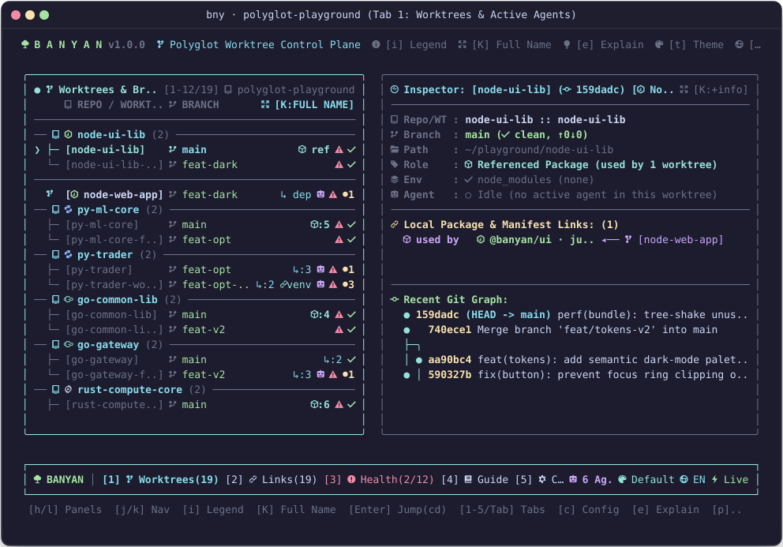
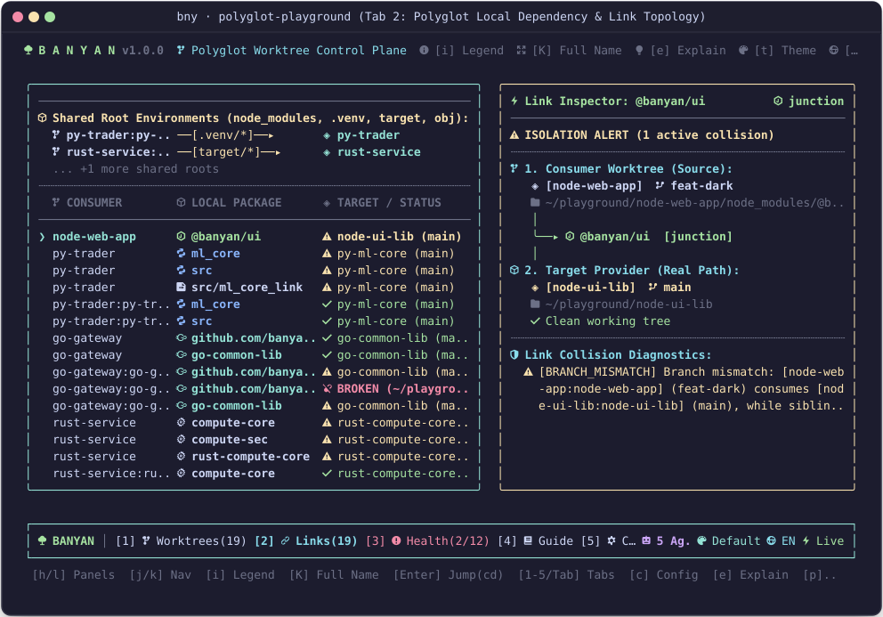
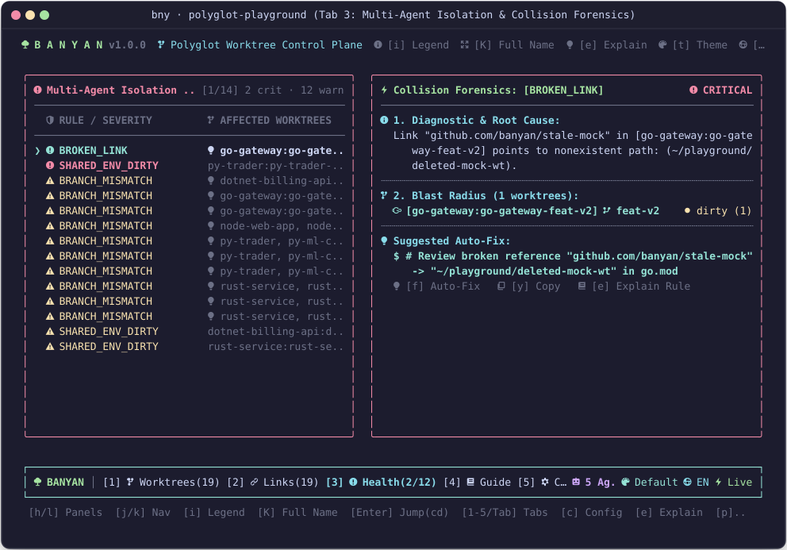
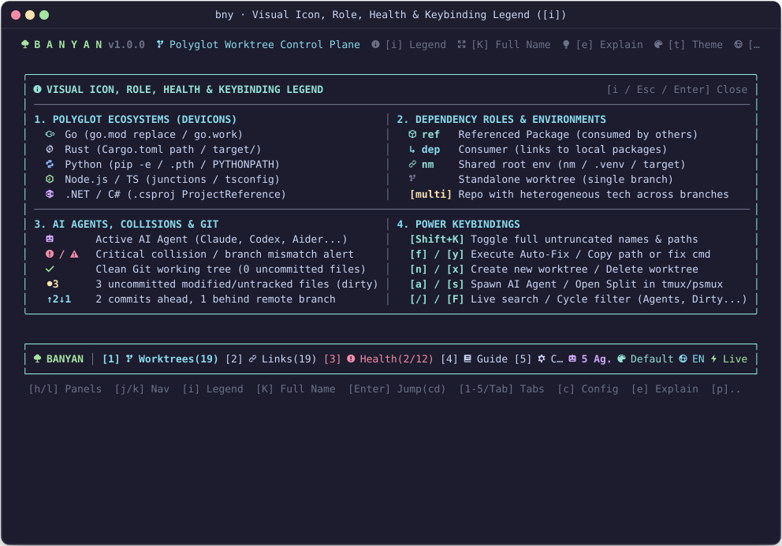
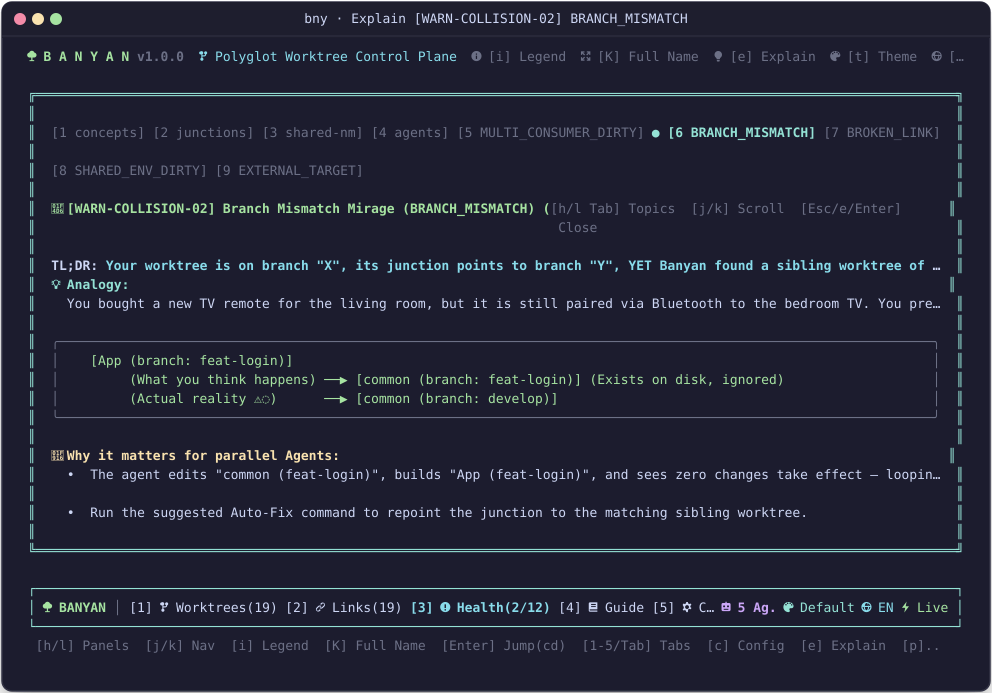
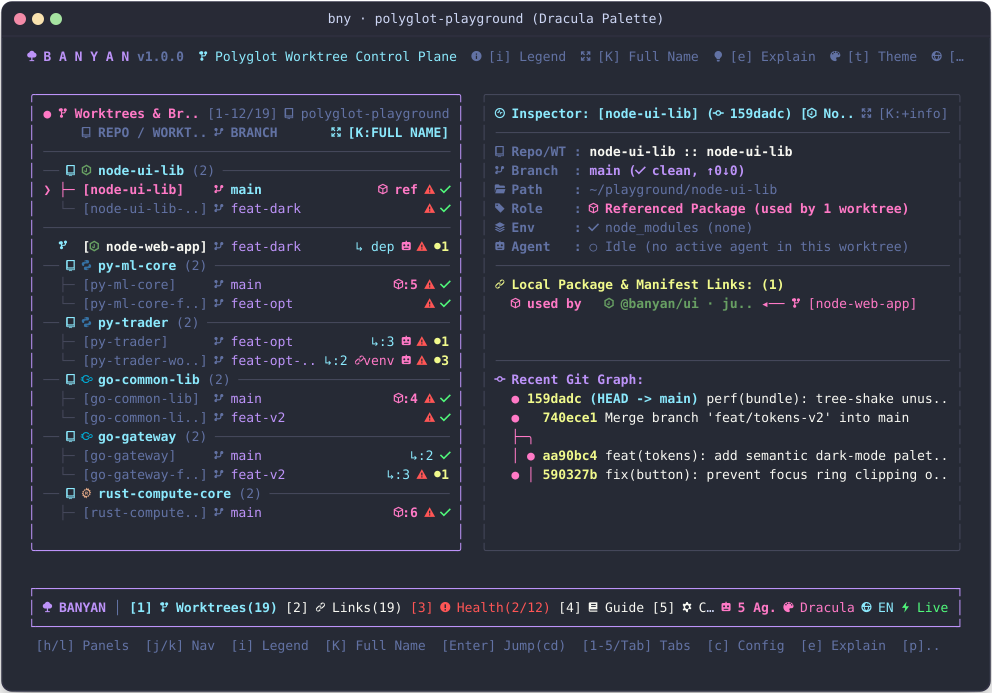
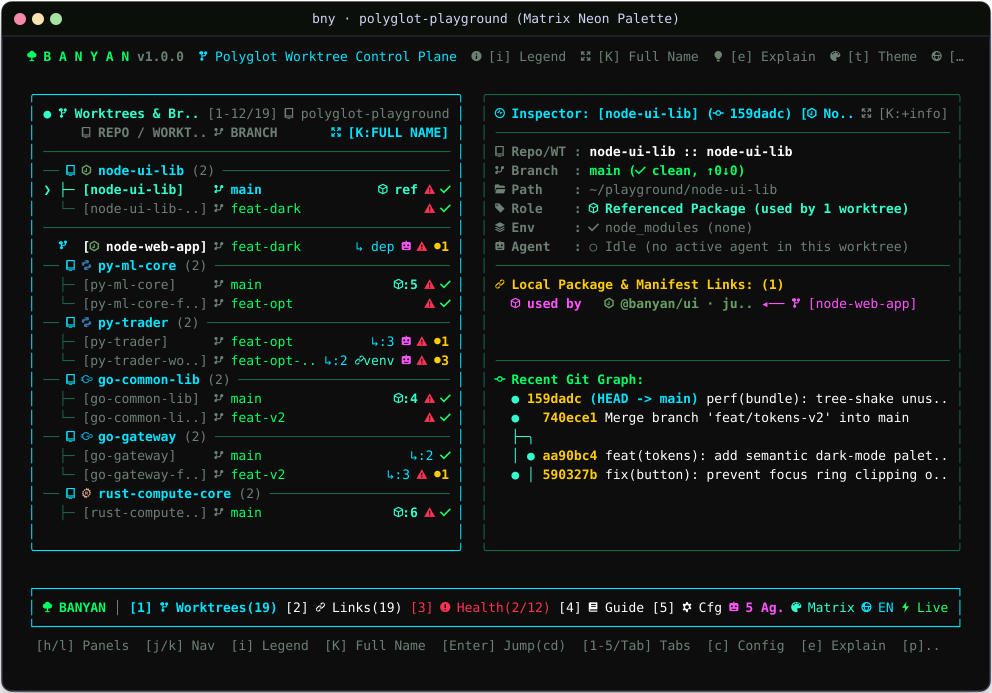

<div align="center">

# 🌳 Banyan (`bny`)

### **Git worktrees isolate your code. Banyan isolates your dependencies.**

*The real-time TUI & MCP Control Plane for parallel AI coding agents across polyglot multi-repo workspaces and Git worktrees.*

[](https://github.com/csarlu/banyan/actions/workflows/ci.yml)
[](https://www.npmjs.com/package/@csarlu/banyan)
[](https://nodejs.org/)
[](https://modelcontextprotocol.io)
[](./LICENSE)

</div>

```text
               %%%%%%..
          %%%%%#@@@@@#**#%▒░▓.
       %%%%%░▓%#*;*## █ ░▒▓▓░░##.
     %%%%% ## %* #%%█%%%,*#; ░▒▓▓▓%.
    %%%%%*#%# %%\ █ ;: ░░▓▒ ░██▒ ▓▓▒░:
   %▒▓░.#*──┬────:   * \ │/  :/ /┌─:*%@%
    ; ░ *#▒▓#──o─┼─┐ \ \│ │ / /─┼─o┼─%@@#
     ; │  │ ││ │ │ │  \ │o│/ /  │  *;┬;·│
       │  ╰o│╯ │ │ │  │o│ │  │  ╰o │ │  │
       ╵  │ ╵  ╵ ╵ │ /│ │ │\ │   ╵ │ ╵  ╵
          ╵    ..─┴─/─┼─│─│─┴┴─..  ╵
            .──┬──/──┼─/│ │\─\──┬──.
         +──/─/  /  /┼/ │o│ \ \  \─┼─\─+
          +  /  o  / / /│ │\ \ o  \ +  +
             ╵  ╵  o ╵  │ │ ╵  o  ╵

 ▄▀▀▄ ▄▀▀▄ █▀▀▄ █  █ ▄▀▀▄ █▀▀▄
 █▀▀▄ █▀▀█ █  █ ▀▄▄▀ █▀▀█ █  █   v1.0.0 · Polyglot Worktree & Dependency
 ▀▀▀  ▀  ▀ ▀  ▀  ▀▀  ▀  ▀ ▀  ▀            Agentic Control Plane
```

---

## ⚡ Why Banyan Exists

Modern engineering teams run **3 to 10 AI coding agents in parallel**—spawning **Claude Code (`claude`)**, **OpenAI Codex CLI (`codex`)**, **Google Antigravity CLI (`agy`)**, or **Aider** across dedicated `git worktree` directories, alongside agentic IDEs like **Cursor**, **Windsurf**, and **Antigravity IDE**.

**Here is the catch:** `git worktree` only isolates tracked source files. It **never** isolates local cross-repo links:
- POSIX symlinks & Windows NTFS junctions (`npm link`, `pnpm link`, shared `node_modules`)
- Python editable installs (`pip install -e`, `.pth`, `.venv` sharing, `PYTHONPATH`)
- Local manifest overrides (`go.mod replace`, `go.work`, `Cargo.toml path`, `.csproj ProjectReference`, `tsconfig.json paths`)

When Agent A edits a shared library or mutates a linked environment, **Agent B silently compiles and tests against Agent A's uncommitted, half-written code.**

**Banyan (`bny`)** solves this in **under 15ms**:
- 🧭 **Maps your entire multi-repo worktree graph** in a 60 FPS interactive TUI with zero-process-spawning filesystem fingerprinting.
- 🤖 **Detects live AI agents** via lockfiles, multiplexer panes (`tmux` / `psmux`), and filesystem write heartbeats.
- 🛡️ **Catches dependency collisions** (`MULTI_CONSUMER_DIRTY`, `BRANCH_MISMATCH`, `SHARED_ENV_DIRTY`, `BROKEN_LINK`) before a single LLM token is wasted.
- 🔧 **Auto-fixes links in one keystroke (`[f]`)** or exposes them directly to your agents via **Model Context Protocol (`bny --mcp`)**.

<details>
<summary><b>🤖 Supported AI Agents, Terminal CLIs & Agentic IDEs (Click to expand)</b></summary>
<br>

Banyan is built first and foremost for **terminal-first multi-agent workflows**, while remaining 100% compatible with GUI agentic IDEs and autonomous CI harnesses:

| Category | Flagship Tools & CLI Binaries | How Banyan Integrates & Detects Activity |
| :--- | :--- | :--- |
| **Terminal-Native Coding Agents (CLIs)** | • **Claude Code** (`claude`)<br>• **OpenAI Codex CLI** (`codex`)<br>• **Google Antigravity CLI** (`agy`)<br>• **Google Gemini CLI** (`gemini`)<br>• **Aider** (`aider`)<br>• **OpenCode** (`opencode`)<br>• **Goose** (`goose`)<br>• **Amp** (`amp`) | • **1-Key Spawning (`[a]`)**: Launch `claude`, `codex`, `agy`, or any custom CLI agent directly into a worktree split pane.<br>• **Pre-Flight Guard (`bny --guard`)**: Hook into `PreToolUse` / shell hooks to block agents before they mutate a shared dependency.<br>• **MCP Server (`bny --mcp`)**: Native stdio MCP tools (`banyan_list_collisions`, `banyan_get_worktree_context`, `banyan_apply_fix`).<br>• **Live Detection**: Multiplexer pane inspection (`tmux` / `psmux`), `.claude*` / `.codex*` / `.agy*` / `.aider*` lockfiles, and sub-second filesystem heartbeats. |
| **Agentic IDEs & GUI Editors** | • **Google Antigravity IDE**<br>• **Cursor**<br>• **Windsurf**<br>• **Zed AI**<br>• **VS Code + GitHub Copilot** | • **MCP Integration**: Connect `bny --mcp` in your IDE's MCP settings for real-time topology queries.<br>• **Context Injection (`bny --init-agent-rules`)**: Populates `AGENTS.md`, `CLAUDE.md`, and `.cursorrules` with workspace guardrails.<br>• **Heartbeat & Lockfile Radar**: Detects active workspace indexing and edits in real time. |
| **IDE Extensions & Autonomous Harnesses** | • **Cline** / **Roo Code**<br>• **Continue.dev**<br>• **OpenHands** / **Devin**<br>• **SWE-agent** | • **Headless JSON & Doctor CLI (`bny --json`, `bny --doctor`)**: Structured diagnostics and exit codes (`0`, `2`, `3`) for automated agentic loops.<br>• **Situational Briefing (`bny --agent-context`)**: Compact `<300-token` Markdown snapshot ready to pipe into any system prompt. |

</details>

---

## 💥 Anatomy of a "Ghost Dependency" Collision

```text
  [Main App (branch: main)]          ─── links to ───►  [@acme/core (branch: main)]
                                                                   ▲
                                                                   │  🚨 Silent Cross-Contamination!
  [Agent Worktree (branch: feat-auth)] ── links to ────────────────┘  (Agent is editing @acme/core)
```

1. **The Setup**: You spawn `claude`, `codex`, or `agy` inside worktree `wt-auth` (`branch: feat-auth`).
2. **The Hidden Link**: Both `main` and `wt-auth` point to `@acme/core` via a local symlink, junction, or editable install.
3. **The Contamination**: The agent modifies `@acme/core` in place. Suddenly your `main` branch fails to build—or worse, deploys experimental agent code.
4. **The Branch Mismatch**: Even if you create a matching `feat-auth` worktree for `@acme/core`, `wt-auth` is **still physically wired** to `@acme/core (main)`. The agent edits `feat-auth`, sees zero effect when running tests, and burns thousands of tokens hallucinating fixes.

> [!TIP]
> **How Banyan Resolves It Instantly:**
> Banyan spots the sibling worktree on disk (`@acme/core` on `feat-auth`), flags a `BRANCH_MISMATCH`, and lets you press **`[f]`** to rewire the symlink/junction/manifest in place—or lets the agent fix it autonomously via MCP.

---

## 🚀 Quick Start (30 Seconds)

### 1. Run or Install

```bash
# Try immediately in any repo or workspace (zero install)
npx -p @csarlu/banyan bny

# Or install globally
npm install -g @csarlu/banyan
bny

# Want to see Banyan in action right now? Launch the 5-language interactive sandbox:
bny --playground
```

<details>
<summary><b>📦 Install from Local Source (Linux / macOS / Windows)</b></summary>
<br>

- **Linux & macOS (Bash/Zsh):**
  ```bash
  chmod +x ./scripts/install.sh && ./scripts/install.sh
  ```
- **Windows (PowerShell):**
  ```powershell
  powershell -ExecutionPolicy Bypass -File .\scripts\install.ps1
  ```

</details>

### 2. Enable Instant Worktree Jumping (`[Enter]` to `cd`)

Banyan renders its TUI on `stderr` and emits the selected path on `stdout`. Add the 1-line shell wrapper so pressing **`[Enter]`** teleports your terminal directly into any worktree:

```bash
# Linux & macOS (~/.bashrc or ~/.zshrc)
eval "$(banyan-bin --init-shell bash)"
```

```powershell
# Windows PowerShell ($PROFILE)
Invoke-Expression (& banyan-bin --init-shell powershell)
```

---

## 📸 Interactive TUI & Architecture Showcase

### 1. Worktrees, Active AI Agents & Branched Git Graph (Tab 1)
Audits multi-repository worktrees grouped with Devicon ecosystem badges (` Go`, ` Rust`, ` Python`, ` Node`, ` .NET`), dependency role indicators (` ref` vs `↳ dep`), live AI agent locks (``), uncommitted dirty file counters, and colored branched Git commit graphs in real time.



---

### 2. Links & Deps — Polyglot Topology & Live Link Inspector (Tab 2)
Master-Detail split architecture that maps local cross-repo links and shared root environments (`node_modules`, `.venv`, `target/`, `obj/`) on the left, paired with a live **Link Inspector** flow diagram (`Consumer ──▸ Package [mechanism] ──▸ Target Provider`) and per-link collision diagnostics on the right.



---

### 3. Health & Collisions — Multi-Agent Isolation & Forensics (Tab 3)
Master-Detail collision radar that lists all active isolation alerts by severity on the left and displays a full **Collision Forensics Console** on the right—complete with root cause analysis, affected worktree **Blast Radius**, and 1-key copy-pasteable or executable Auto-Fix commands (`[f]`).



---

### 4. Interactive Visual Legend (`[i]`) & Pedagogical Explain Modal (`[e]`)
Press **`[i]`** from any screen to open the 4-quadrant **Visual Icon, Role, Health & Keybinding Legend**, or press **`[e]`** to inspect every collision rule with ASCII topology diagrams, real-world analogies, and AI agent failure modes.



<br>



---

### 5. Color Themes Carousel (`[t]`)
Switch between 7 built-in 24-bit TrueColor themes on the fly by pressing **`[t]`**:

| Catppuccin Mocha | Dracula Pro Palette | Matrix Neon Green |
| :---: | :---: | :---: |
|  |  |  |

---

## 🌐 Polyglot Ecosystem Adapters

Banyan inspects manifests, symlinks, and junctions directly via asynchronous filesystem calls (`fs.promises`, `lstat`). It **never** spawns heavy compilers (`cargo`, `pip`, `dotnet`, `go`), guaranteeing sub-15ms scans and 60 FPS rendering:

| Ecosystem | Local Link Mechanism | Shared Root Env | What Banyan Audits on Disk |
| :--- | :--- | :--- | :--- |
| **Node.js / TS** | `symlink` / `fs-junction`, `tsconfig-path` | `node_modules` | Symlinks & NTFS Junctions in `node_modules` + `compilerOptions.paths` in `tsconfig.json` |
| **Python** | `pip-editable`, `pythonpath-override` | `.venv` / `venv` | PEP 610 `direct_url.json`, `.pth`, `.egg-link`, `.env` `PYTHONPATH`, and `sys.path.append()` |
| **Go (Golang)** | `go-mod-replace` | — | `replace x => ../path` directives in `go.mod` and `use ../path` in `go.work` |
| **Rust (Cargo)** | `cargo-path` | `target/` | `path = "../lib"` in `Cargo.toml` / `.cargo/config.toml` and shared `target/` symlinks |
| **.NET (C#)** | `dotnet-projref` | `obj/` / `bin/` | `<ProjectReference Include="..."/>` in `*.csproj` |
| **Raw Source** | `source-symlink` | — | Direct folder/file symlinks or junctions anywhere in the source tree (up to depth 3) |

---

## 🛡️ The 5 Mathematical Collision Rules

Banyan's engine evaluates 5 formal graph invariants on every scan. Click any rule below to see a real-world scenario, topology diagram, and exact auto-fix:

| Rule ID | Severity | What It Detects | One-Key Auto-Fix (`[f]`) |
| :--- | :--- | :--- | :--- |
| **`MULTI_CONSUMER_DIRTY`** | 🚨 **Critical** | 2+ worktrees link to a local dependency that has uncommitted changes or an active AI agent. | Creates an isolated sibling worktree (`git worktree add`). |
| **`BRANCH_MISMATCH`** | ⚠️ **Warning** | Worktree on branch `X` links to dependency on branch `Y`, while a sibling dependency worktree on branch `X` exists. | Rewires the symlink / NTFS junction / manifest to the matching branch `X` worktree. |
| **`BROKEN_LINK`** | 🚨 **Critical** | A symlink, junction, or manifest path points to a worktree directory that was deleted. | Cleans up the dead link or re-points to the primary repository worktree. |
| **`SHARED_ENV_DIRTY`** | ⚠️ **Warning** | Multiple worktrees share a root `node_modules`, `.venv`, or `target/` while one is dirty or has an active agent. | Unlinks the shared environment folder so dependencies can be installed independently. |
| **`EXTERNAL_TARGET`** | ℹ️ **Info** | A dependency link points outside the monitored Banyan workspace radar. | Generates the config snippet to register the external repository in `banyan.config.json`. |

<details>
<summary><b>🔍 Deep-Dive: Diagrams & Real-World Scenarios for All 5 Rules (Click to expand)</b></summary>
<br>

### 1. `MULTI_CONSUMER_DIRTY` (Critical 🚨)
> *Analogy: Two chefs cooking different dishes in the same frying pan while one tosses in chili flakes unannounced.*

```text
[Agent 1: Stable Worktree]     ───(reads)───►
                                              ▼
                              [ Shared Library: ⚠️ 4 dirty files / 🤖 Active Agent ]
                                              ▲
[Agent 2: Feature Worktree]    ───(edits)───►
```
- **Failure Mode:** Stable worktree `app:main` silently ingests half-baked code from `common:develop`. Tests fail for reasons unrelated to `main`, causing agents in `main` to hallucinate fixes.
- **Auto-Fix:** Isolates the library into a dedicated worktree (`git worktree add ../common-feat`).

---

### 2. `BRANCH_MISMATCH` (Warning ⚠️)
> *Analogy: Pressing buttons on a new living room TV remote that is still Bluetooth-paired to the bedroom TV.*

```text
[App Worktree (branch: feat-login)]
     (Expected target) ──► [@acme/ui (branch: feat-login)] (Exists on disk, but ignored!)
     (Actual link ⚠️)  ──► [@acme/ui (branch: develop)]
```
- **Failure Mode:** The agent edits `ui (feat-login)` and tests `app (feat-login)`, seeing zero changes because the symlink still points to `ui (develop)`.
- **Auto-Fix:** Rewires the link to the matching branch worktree:
  ```bash
  # Linux/macOS: ln -sfn ../ui-feat-login node_modules/@acme/ui
  # Windows:     cmd /c rmdir node_modules\@acme\ui && mklink /J node_modules\@acme\ui ..\ui-feat-login
  ```

---

### 3. `BROKEN_LINK` (Critical 🚨)
> *Analogy: A hallway door opening into an empty elevator shaft after the adjacent building was removed.*

```text
[App Worktree] ───(symlink/junction)───► ✖ /projects/old-worktree (Deleted from disk)
```
- **Failure Mode:** Compilers and test runners crash immediately with `ENOENT` or module resolution errors.
- **Auto-Fix:** Removes the dangling symlink/junction cleanly.

---

### 4. `SHARED_ENV_DIRTY` (Warning ⚠️)
> *Analogy: Sharing a communal refrigerator where one roommate replaces all the ingredients mid-recipe.*

```text
[Feature Worktree] (🔗nm) ──(shared root)──► [Main Worktree] (node_modules modified by agent ⚠️)
                                                    ▲
[Hotfix Worktree]  (🔗nm) ──(shared root)──────────┘
```
- **Failure Mode:** Sharing a root `node_modules` or `.venv` saves disk space, but if an agent runs `npm install` or `pip install`, sibling worktrees break.
- **Auto-Fix:** Unlinks the root folder before mutating packages.

---

### 5. `EXTERNAL_TARGET` (Info ℹ️)
```text
[Monitored App Worktree] ───(link)───► 📁 /external/untracked-repo (Outside Banyan radar)
```
- **Failure Mode:** Banyan cannot audit git status or agent locks on untracked external paths.
- **Auto-Fix:** Adds the external repository to `banyan.config.json`.

</details>

---

## 🤖 Equipping Your AI Agents (`MCP`, `Guard`, & `Context`)

Give `claude`, `codex`, `agy`, `cursor`, and `aider` full self-awareness of your worktree graph:

```bash
# 1. Inject Banyan topological rules into AGENTS.md / CLAUDE.md
bny --init-agent-rules

# 2. Print a <300-token situational Markdown briefing for the current worktree
bny --agent-context

# 3. Pre-commit / Agent Hook gatekeeper (Exit 0 = Clean, 2 = Critical Collision, 3 = Branch Mismatch)
bny --guard

# 4. Start the stdio Model Context Protocol (MCP) server (safe dry-run by default)
bny --mcp

# 5. Start MCP server with auto-fix command execution enabled (explicit opt-in)
bny --mcp --allow-fix
# or via environment variable:
export BANYAN_MCP_ALLOW_FIX=1
bny --mcp
```

---

## ⌨️ Interactive TUI & Multiplexer Keybindings

Banyan groups multi-worktree repositories automatically with tree connectors (`├─`, `└─`) and integrates natively with **`tmux`** (Linux/macOS), **`psmux`** (Windows), and **Windows Terminal (`wt.exe`)**:

| Key | Action |
| :--- | :--- |
| **`[j / k]`** or **`[↑ / ↓]`** | Navigate worktrees, dependency links, and collision alerts (`[g / G]` jump to first / last) |
| **`[h / l]`** or **`[← / →]`** | Switch between Left/Right panels and Tabs |
| **`[Enter]`** | **Instant Jump (`cd`)** into the selected worktree (or open Config editor in Tab 5) |
| **`[i]`** | **Visual Legend Modal**: Inspect all Devicon ecosystems, dependency roles (` ref`, `↳ dep`), health icons, and shortcuts |
| **`[Shift + K]`** | **Full Name Toggle**: Expand or compact truncated repository names, worktree IDs, and filesystem paths live |
| **`[/]`** | **Vim Search**: Filter worktrees and dependency links in real time (`[Esc]` to clear) |
| **`[F]`** | **Quick Filter**: Cycle `All` ➔ ` Active Agents` ➔ ` Collisions` ➔ ` Dirty` |
| **`[n]`** / **`[x]`** | **New Worktree Wizard (`[n]`)** (`own`, `shared`, or `branch-matched`) or **Delete Worktree (`[x]`)** |
| **`[a]`** | **Spawn CLI Agent**: Launch `claude`, `codex`, `agy`, or custom agent in a horizontal multiplexer split |
| **`[f]`** / **`[y]`** | **Auto-Fix (`[f]`)** the selected collision with confirmation, or **Yank (`[y]`)** path/command to clipboard |
| **`[s]`** / **`[w]`** | Open a **Split Pane (`[s]`)** or **New Window (`[w]`)** at the selected worktree in `tmux` / `psmux` |
| **`[c]`** | Open `banyan.config.json` in **Neovim (`nvim`)** or `$EDITOR` (supports inline, split `[s]`, or tab `[v]`) |
| **`[e]`** | Open the **Architecture & Collision Explainer Modal** with interactive ASCII diagrams |
| **`[b]`** | Display the full-screen **Banyan Tree ASCII Artwork** showcase |
| **`[p]`** / **`[r]`** | **Pause/Resume (`[p]`)** live background polling or trigger an immediate **Refresh (`[r]`)** |
| **`[t]`** / **`[L]`** | Cycle through **7 Color Themes (`[t]`)** and toggle **Spanish / English (`[L]`)** live |
| **`[1 - 5]`** / **`[q]`** | Jump directly to Tabs `1–5` or Quit (`[q]`) |

---

## 🌍 Language (English / Español)

Banyan ships with **English** (default) and **Spanish**. Resolution order:

1. `--lang en|es` (or `-l`)
2. `BANYAN_LANG` environment variable
3. `lang` in the active workspace (or top level) of `banyan.config.json`
4. System locale (`LC_ALL` / `LANG` starting with `es` selects Spanish)
5. English

Inside the TUI press **`[L]`** to toggle the language live. This covers the TUI, `--help`, `--status`, `--doctor`, `--explain`, `--agent-context`/`--guard` and the playground README.
## 📄 License

[MIT](./LICENSE)
